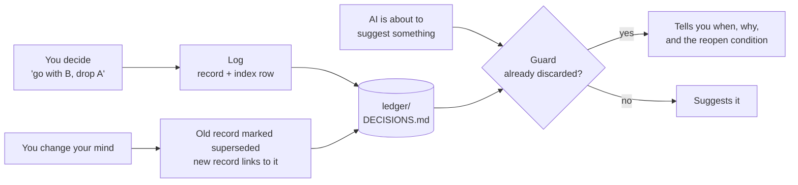

<div align="center">

# 📒 Decision Ledger

### Your AI remembers what you said. It forgets what you said no to.

A free skill that gives Claude and ChatGPT a memory of your **decisions**, including the ideas you already rejected, why you rejected them, and what would make you look again.

[](LICENSE)
[](#install-in-claude-code)
[](#use-it-in-claudeai-or-chatgpt)
[](#your-data)

**[Install in 10 minutes](#install-in-claude-code)** · **[See a real record](examples/2026-03-02-pricing-model.md)** · **[How it works](#how-it-works)**

</div>

---

## The problem

You decided against a free tier in March. You had good reasons.

In May your AI suggests a free tier. You explain again. In July it suggests it again, phrased a little differently. Every few weeks you argue with your own past self, and the AI takes the side of whoever spoke last.

AI memory keeps what you said. It rarely keeps what you **ruled out**, and it never keeps the condition under which you would change your mind. That missing half is where the loop comes from.

## The fix

```
You:    We get 11 paid signups a month. How should I grow this?

Claude: I'd usually suggest a free tier, but you discarded that on 2026-03-02.
        Free users never upgraded in your last product. You said you'd only
        reopen it if paid signups stall below 5 a month for 2 months.
        At 11 a month that hasn't happened, so here's what I'd do instead...
```

Decision Ledger keeps a short record of every decision and every option that lost, with the reason and a **"reopen only if"** condition. Your AI reads it before it recommends anything.

---

## How it works



It does five things.

| | What it does | You say | It does |
|---|---|---|---|
| 🌱 | **Seed** | `/decision-ledger seed` | Interviews you for 10 minutes, one question at a time, about your last 5 real decisions, so the ledger protects you from day one |
| ✍️ | **Log** | "let's go with B", "drop that", "park it" | Confirms in one line, asks for any missing reason (never invents one), writes the record, adds a row to the index |
| 🛡️ | **Guard** | nothing, it runs on its own | Before recommending a price, tool, channel, name or plan, checks what you discarded and tells you instead of re-pitching it |
| 🔎 | **Recall** | "why did we pick €39?", "did we already try Instagram?" | Answers with the date and the reason in your own words. If nothing is logged, it says so and does not guess |
| 🔁 | **Revisit** | "what's due for a revisit?" | Flags decisions whose revisit date has passed. When you change your mind, the old decision stays, marked superseded, so you can see how your thinking moved |

### Why it actually works

An instruction like "check my decisions first" gets skipped the moment a question looks simple. So the ledger does not rely on the AI remembering to look.

One line in your `CLAUDE.md` loads the decision index into **every** session. The check costs nothing and cannot be skipped. That is also why the index stays short, one row per decision, short names in the Discarded column.

---

## What a record looks like

Each decision is one small markdown file. This is the heart of it.

```markdown
# Charge a flat €29 a month, no free tier

Date: 2026-03-02
Status: superseded
Area: pricing
Revisit: 2026-06-01 or when we pass 50 customers

## Decision
One plan, €29 a month, cancel any time. No free tier.

## Why
Our buyers are solo coaches. In 6 sales calls, 4 asked "how much is it
for just me". Per seat pricing made them do maths before they saw the product.

## Discarded
- Per seat pricing: scared off solo buyers in calls.
  Reopen only if: a team of 5 or more asks for it.
- Free tier: support load with no revenue, free users never upgraded.
  Reopen only if: paid signups stall below 5 a month for 2 months.
- Lifetime deal: cash now, support forever.
  Reopen only if: we need runway in under 30 days.

Superseded by: 2026-04-20-price-39.md
```

And the index your AI reads every session:

| Date | Decision | Discarded | Status | Revisit | Record |
|---|---|---|---|---|---|
| 2026-05-12 | Instagram paused, TikTok only | Instagram Reels, YouTube Shorts | active | 2026-08-12 | [record](examples/2026-05-12-one-channel.md) |
| 2026-04-20 | Flat €39/month, annual €390 | €29/month, per seat | active | 2026-07-20 | [record](examples/2026-04-20-price-39.md) |
| 2026-03-02 | Flat €29/month | per seat, free tier, lifetime deal | superseded | 2026-06-01 | [record](examples/2026-03-02-pricing-model.md) |

The three examples follow a made up coaching app that set a price, raised it seven weeks later and paused Instagram. Read them in order to see how a decision changes without losing its history.

**Statuses** `open` still deciding · `active` in force · `superseded` replaced by a newer decision · `reversed` undone

---

## Install in Claude Code

About 10 minutes. Run these from the folder where you downloaded this repo.

**1. Copy the skill**

macOS or Linux
```bash
mkdir -p ~/.claude/skills/decision-ledger && cp skills/decision-ledger/SKILL.md ~/.claude/skills/decision-ledger/
```

Windows (PowerShell)
```powershell
New-Item -ItemType Directory -Force $HOME\.claude\skills\decision-ledger; Copy-Item skills\decision-ledger\SKILL.md $HOME\.claude\skills\decision-ledger\
```

> ✅ Check that the file is at `~/.claude/skills/decision-ledger/SKILL.md`. If it sits directly inside `skills/`, it will not load.

**2. Add an empty ledger to your project**

Copy the `ledger/` folder into your project folder.

> Want one ledger for all your projects? Put `ledger/` in your home folder and follow the full path note at the end of [`setup/CLAUDE-snippet.md`](setup/CLAUDE-snippet.md).

**3. Make the guard run every session**

Open the `CLAUDE.md` in your project folder (create an empty one if you have none) and paste the block from [`setup/CLAUDE-snippet.md`](setup/CLAUDE-snippet.md).

**4. Seed it**

Open a terminal in your project folder, start Claude Code there and type

```
/decision-ledger seed
```

It interviews you about your last 5 real decisions. An empty ledger protects nothing, so this is the step that makes it pay off.

---

## Use it in Claude.ai or ChatGPT

No terminal needed. You keep one file and the AI reads it in every chat.

1. Create a **Project** in Claude.ai or ChatGPT.
2. Upload `ledger/DECISIONS.md` as project knowledge.
3. Paste the instructions from [`setup/claude-ai-and-chatgpt.md`](setup/claude-ai-and-chatgpt.md).
4. Paste the seed prompt from the same file to fill it with your last 5 decisions.

The AI cannot write files here, so when it logs a decision it hands you a ready row and a ready record to paste in. Once a week is enough if you batch them.

---

## Everyday use

Just talk the way you already do. A few things worth knowing:

- **Ideas are not decisions.** It only logs what you commit to ("let's do it", "approved", "kill it", "park that"). Brainstorming stays out of the ledger.
- **Discarding counts.** "Drop the podcast idea" is a decision, and the most valuable kind to keep.
- **No reason, no invention.** If you do not say why, it asks once. If you still do not say, it writes `reason not given` rather than making one up.
- **Absolute dates only.** "Last week" means nothing in two months.
- **Disagreeing is allowed.** If the AI thinks an active decision is wrong, it must name the decision first and then make its case. It never works around it quietly.

Good questions to ask

```
Why did we pick €39?
Did we already try Instagram?
What did we discard about pricing?
What's due for a revisit?
Has the reopen condition for the free tier been met?
```

---

## Your data

Your ledger is plain markdown in your own folder. There is no account, no server and no database (unless you choose Notion mode, then it lives in your own Notion workspace). Nothing leaves your computer beyond what your AI tool already sees in a normal session. You can read it, edit it, put it in git or delete it at any time.

---

## FAQ

**Doesn't Claude or ChatGPT memory already do this?**
Built in memory keeps facts about you. It does not keep which options you rejected, why, or under what condition you would reconsider, and it does not stop the AI from suggesting them. The ledger does exactly that one thing.

**Will it slow my sessions down?**
The index is one short table. Your AI reads it in a moment, and opens a full record only when it needs the reason.

**Can I use one ledger across several projects?**
Yes. Put the folder in your home directory and use the full path in your `CLAUDE.md`. See [`setup/CLAUDE-snippet.md`](setup/CLAUDE-snippet.md).

**What happens when I change my mind?**
The old decision is marked `superseded` and linked to the new one. Nothing is deleted or rewritten to look like it was always right. The trail is the point.

**Does it work for a team?**
Put the `ledger/` folder in your shared repo. Everyone's AI then reads the same decisions, which is also a quick way to onboard someone new.

**Does it work with Notion?**
Yes. Create one database, paste a block into your `CLAUDE.md`, and the skill reads and writes rows through the Notion MCP tools instead of files. See [`setup/notion.md`](setup/notion.md).

---

## Roadmap

- [x] Claude Code skill with seed, log, guard, recall and revisit
- [x] Claude.ai and ChatGPT Projects version
- [x] Notion database version
- [ ] Weekly review prompt that lists decisions due for a revisit
- [ ] More example ledgers (agency, solo consultant, product team)

Ideas and bug reports are welcome in [Issues](../../issues).

---

## Files

| Path | What it is |
|---|---|
| [`skills/decision-ledger/SKILL.md`](skills/decision-ledger/SKILL.md) | The skill Claude Code follows |
| [`ledger/DECISIONS.md`](ledger/DECISIONS.md) | Your empty ledger index |
| [`setup/CLAUDE-snippet.md`](setup/CLAUDE-snippet.md) | Paste into CLAUDE.md so the guard always runs |
| [`setup/claude-ai-and-chatgpt.md`](setup/claude-ai-and-chatgpt.md) | Version for Claude.ai and ChatGPT Projects |
| [`setup/notion.md`](setup/notion.md) | Keep the ledger in a Notion database |
| [`examples/`](examples/) | Three filled records and their index |

---

<div align="center">

If it saves you one repeated argument, a ⭐ helps other people find it.

Made by **Nina Niamh Cressoni** · [ninaneev.github.io](https://ninaneev.github.io) · [TikTok](https://www.tiktok.com/@nina.neev)

MIT licensed. Use it, change it, share it.

</div>
