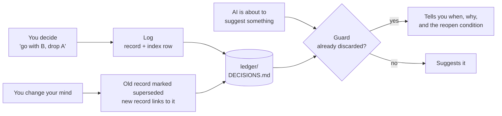
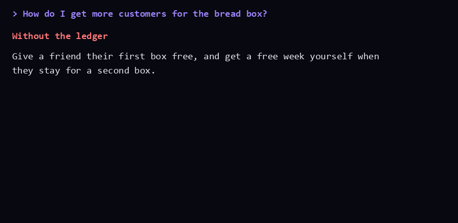

<div align="center">

# 📒 Decision Ledger

### Your AI remembers what you said. It forgets what you said no to.

A free skill that gives your AI a memory of your **business decisions** (pricing, channels, offers, hires), including the ideas you already rejected, why you rejected them, and what would make you look again.

[](LICENSE)
[](#install-in-claude-code)
[](#works-with)
[](#pick-where-it-lives)

**[Install in 10 minutes](#install-in-claude-code)** · **[Let your AI install it](#let-your-ai-install-it)** · **[See an example record](examples/2026-04-20-bread-box.md)** · **[How it works](#how-it-works)**

</div>

---

## The problem

You decided against the food delivery apps in May. You had good reasons.

In June your AI suggests the delivery apps. You explain again. In August it suggests them again, phrased a little differently. Every few weeks you argue with your own past self, and the AI takes the side of whoever spoke last.

AI memory keeps what you said. It rarely keeps what you **ruled out**, and it never keeps the condition under which you would change your mind. That missing half is where the loop comes from.

## The fix

The exchange below is a fictional example, about a made up bakery called Little Oven.

```
You:    Orders are flat at 140 a week. How do we grow?

Claude: I'd usually suggest the food delivery apps, but you discarded them
        on 2026-05-12. They take 30% of each order and the customers become
        theirs. You said you'd only reopen that if a second bakery opens
        within 1 km. That hasn't happened.
        One fixed point first. The corner kitchen lease (2026-06-03) can't
        be undone, so every idea below has to fit that one oven...
```

Decision Ledger keeps a short record of every decision and every option that lost, with the reason and a **"reopen only if"** condition. Your AI reads it before it recommends anything.

---

## How it works



It does five things.

| | What it does | You say | It does |
|---|---|---|---|
| 🌱 | **Seed** | `/decision-ledger seed` | Interviews you for 10 minutes, one question at a time, about your last 5 real decisions and the rules you never break, so the ledger protects you from day one |
| ✍️ | **Log** | "let's go with B", "drop that", "park it" | Confirms in one line, asks for any missing reason (never invents one) and whether it can be undone, writes the record, adds a row to the index |
| 🛡️ | **Guard** | nothing, it runs on its own | Before recommending a price, tool, channel, offer, hire or plan, checks your invariants and what you discarded, and tells you instead of re-pitching it. Irreversible decisions are always named first |
| 🔎 | **Recall** | "why did we pick the bread box?", "did we already try ads?" | Answers with the date and the reason in your own words. If nothing is logged, it says so and does not guess |
| 🔁 | **Revisit** | "what's due for a revisit?" | Flags decisions whose revisit date has passed. When you change your mind, the old decision stays, marked superseded, so you can see how your thinking moved |

### Why it actually works

An instruction like "check my decisions first" gets skipped the moment a question looks simple. So the ledger does not rely on the AI remembering to look.

One line in your `CLAUDE.md` loads the decision index into **every** session. The check costs nothing and cannot be skipped. That is also why the index stays short, one row per decision, short names in the Discarded column. Past about 40 rows the skill offers to move old superseded rows into `ledger/ARCHIVE.md`.

Want it enforced even after long sessions get compacted? Add the optional [SessionStart hook](setup/CLAUDE-snippet.md#optional-enforce-it-with-a-sessionstart-hook). It prints the index into Claude's context at every start, `/clear` and compaction.

---

## What a record looks like

Each decision is one small markdown file. The format is a light version of [MADR](https://adr.github.io/madr/), the Markdown Architecture Decision Record, cut down for business decisions. This is a fictional example.

```markdown
# Sell a weekly bread box at €18, delivery included

Date: 2026-04-20
Status: active
Area: offer
Reversible: yes
Revisit: 2026-07-20

## Decision
A weekly box of two loaves and four pastries for €18, delivered
every Saturday morning. Single orders stay at €3 delivery.

## Why
Most orders were the same three items every week. A fixed Saturday
route lets one rider do 30 drops in two hours, and we bake to a
known number with almost no waste.

## Discarded
- Keep only single orders: riders crossed the same street five times a day.
  Reopen only if: box subscribers drop below 20.
- Daily box: we cannot bake that much before 7am with one oven.
  Reopen only if: we get a second oven.

## Supersedes
2026-03-02-pricing-model.md
```

And the index your AI reads every session (fictional example)

**Invariants** are rules that must never be broken. The guard checks them first.

| Since | Rule | Why |
|---|---|---|
| 2026-03-02 | Bread goes out the same day it is baked | Fresh bread at the door is the whole promise |
| 2026-03-02 | No customer addresses outside our own list | Neighbours trust us with their door codes |

**Decisions**

| Date | Decision | Discarded | Reversible | Status | Revisit | Record |
|---|---|---|---|---|---|---|
| 2026-06-03 | 3 year lease on the corner kitchen | shared kitchen across town, home kitchen | no | active | 2027-06-03 | [record](examples/2026-06-03-kitchen-lease.md) |
| 2026-05-12 | Building lobbies only, 90 days | food delivery apps, paid local ads | yes | active | 2026-08-10 | [record](examples/2026-05-12-one-channel.md) |
| 2026-04-20 | Weekly bread box €18, delivery included | single orders only, daily box | yes | active | 2026-07-20 | [record](examples/2026-04-20-bread-box.md) |
| 2026-03-02 | €3 delivery fee per order | free delivery over €25, free delivery, loyalty card | yes | superseded | 2026-06-01 | [record](examples/2026-03-02-pricing-model.md) |

The four examples follow Little Oven, a made up neighbourhood bakery that delivers by bike. It set a delivery fee, replaced it with a bread box seven weeks later, picked one marketing channel and signed a lease it cannot undo. Read them in order to see how a decision changes without losing its history.

**Statuses** `open` still deciding · `active` in force · `superseded` replaced by a newer decision · `reversed` undone

**Reversible** `yes` cheap to undo · `no` costs real money, time or trust to undo. The guard names every `no` before suggesting anything in the same area.

---

## Works with

| Tool | How | Setup |
|---|---|---|
| Claude Code | Skill + `CLAUDE.md` import, optional hook | [below](#install-in-claude-code) |
| Claude.ai Projects | Project instructions + knowledge file | [`claude-ai-and-chatgpt.md`](setup/claude-ai-and-chatgpt.md) |
| ChatGPT Projects | Project instructions + project file | [`claude-ai-and-chatgpt.md`](setup/claude-ai-and-chatgpt.md) |
| ChatGPT custom GPT | Instructions + knowledge file (OpenAI is retiring custom GPTs, see the file) | [`claude-ai-and-chatgpt.md`](setup/claude-ai-and-chatgpt.md#chatgpt-custom-gpt) |
| OpenAI Codex CLI | Skill + `AGENTS.md` | [`other-tools.md`](setup/other-tools.md#openai-codex-cli) |
| Gemini CLI | Skill + `GEMINI.md` | [`other-tools.md`](setup/other-tools.md#gemini-cli) |
| Cursor | Skill + rule file or `AGENTS.md` | [`other-tools.md`](setup/other-tools.md#cursor) |
| Cline | Skill + `.clinerules/` | [`other-tools.md`](setup/other-tools.md#cline) |
| Windsurf (now Devin Local) | Skill + `AGENTS.md` | [`other-tools.md`](setup/other-tools.md#windsurf-now-devin-local) |
| OpenClaw | Skill + workspace `AGENTS.md` | [`other-tools.md`](setup/other-tools.md#openclaw) |

## Pick where it lives

| Backend | Needs | Setup |
|---|---|---|
| Markdown files (default) | Nothing | this README |
| Notion | Notion connector, once. The skill can create the database for you | [`storage.md`](setup/storage.md#notion) |
| Airtable | Airtable connector, once. The skill can create the table for you | [`storage.md`](setup/storage.md#airtable) |
| Spreadsheet (CSV, Excel, Google Sheets) | A file. A Google Sheets connector is optional | [`storage.md`](setup/storage.md#spreadsheet) |

---

## Let your AI install it

Open Claude Code (or Codex, Gemini CLI, Cursor or Cline) in your project folder and paste this line.

```
Install the Decision Ledger for me. Follow INSTALL-AGENT.md from https://github.com/ninaneev/decision-ledger
```

It asks you three questions, installs the skill, adds the ledger and the guard, and prints a checklist. The runbook it follows is [`INSTALL-AGENT.md`](INSTALL-AGENT.md).

---

## Install in Claude Code

About 10 minutes. Download this repo, open a terminal in the downloaded folder, and run the commands from there.

**1. Copy the skill**

macOS or Linux
```bash
mkdir -p ~/.claude/skills/decision-ledger && cp skills/decision-ledger/SKILL.md ~/.claude/skills/decision-ledger/
```

Windows (PowerShell)
```powershell
New-Item -ItemType Directory -Force $HOME\.claude\skills\decision-ledger; Copy-Item skills\decision-ledger\SKILL.md $HOME\.claude\skills\decision-ledger\
```

> ✅ Check that the file is at `~/.claude/skills/decision-ledger/SKILL.md`. If it sits directly inside `skills/`, it will not load.

**2. Add an empty ledger to your project**

The `ledger/` folder is where your decisions are stored. It holds one file to start with, `DECISIONS.md`, the index your AI reads every session. Right now it has only its headers (an empty Invariants table and an empty Decisions table). Each decision you log later adds one row there and one small record file next to it.

Your **project folder** is the folder you open Claude Code in, the one where you type `claude`. Put `ledger/` directly inside it, next to your `CLAUDE.md`.

```
my-business/                  ← your project folder (where you start Claude Code)
├── CLAUDE.md                 ← step 3 adds the guard here
├── ledger/                   ← copied in this step
│   └── DECISIONS.md          ← the index, empty until you seed it
└── ...your other files
```

After a few weeks it looks like this.

```
my-business/ledger/
├── DECISIONS.md
├── 2026-04-20-bread-box.md
└── 2026-05-12-one-channel.md
```

From the terminal (still in the downloaded repo folder)

macOS or Linux
```bash
cp -r ledger /path/to/my-business/
```

Windows (PowerShell)
```powershell
Copy-Item -Recurse ledger C:\path\to\my-business\
```

By hand, copy the `ledger` folder from the download and paste it into your project folder. Or create a folder called `ledger` there and save [`ledger/DECISIONS.md`](ledger/DECISIONS.md) inside it.

It starts empty on purpose. Step 4 fills it.

| Option | Where `ledger/` goes | Good for |
|---|---|---|
| One ledger per project (default) | Inside each project folder | Separate businesses or clients that should not mix |
| One shared ledger | Your home folder, for example `~/ledger/` | One business you work on from several folders. Use the full path in `CLAUDE.md`, see [`CLAUDE-snippet.md`](setup/CLAUDE-snippet.md) |

> Using a chat tool (Claude.ai, ChatGPT) or keeping the ledger in Notion, Airtable or a sheet? Skip this step. Your backend setup replaces it, see [Works with](#works-with) and [Pick where it lives](#pick-where-it-lives).

**3. Make the guard run every session**

Open the `CLAUDE.md` in your project folder (create an empty one if you have none) and paste the block from [`setup/CLAUDE-snippet.md`](setup/CLAUDE-snippet.md). The same file has the optional SessionStart hook.

**4. Seed it**

Open a terminal in your project folder, start Claude Code there and type

```
/decision-ledger seed
```

It interviews you about your last 5 real decisions. An empty ledger protects nothing, so this is the step that makes it pay off.

---

## Use it in Claude.ai or ChatGPT

No terminal needed. You keep one file and the AI reads it in every chat.

1. Create a **Project** in Claude.ai or ChatGPT.
2. Upload `ledger/DECISIONS.md` as project knowledge (Claude.ai) or a project file (ChatGPT).
3. Paste the instructions from [`setup/claude-ai-and-chatgpt.md`](setup/claude-ai-and-chatgpt.md).
4. Paste the seed prompt from the same file to fill it with your last 5 decisions.

The AI cannot write files here, so when it logs a decision it hands you a ready row and a ready record to paste in. Once a week is enough if you batch them.

---

## Everyday use

Just talk the way you already do. A few things worth knowing.

- **Ideas are not decisions.** It only logs what you commit to ("let's do it", "approved", "kill it", "park that"). Brainstorming stays out of the ledger.
- **Discarding counts.** "Drop the podcast idea" is a decision, and the most valuable kind to keep.
- **No reason, no invention.** If you do not say why, it asks once. If you still do not say, it writes `reason not given` rather than making one up.
- **Some things cannot be undone.** A lease, a hire or a public promise gets `Reversible: no`, and the AI names it before suggesting anything nearby.
- **Some rules never bend.** Put them in Invariants. The AI will not suggest breaking them.
- **Absolute dates only.** "Last week" means nothing in two months.
- **Disagreeing is allowed.** If the AI thinks an active decision is wrong, it must name the decision first and then make its case. It never works around it quietly.

Good questions to ask

```
Why did we pick the bread box?
Did we already try paid ads?
What did we discard about pricing?
What can't we undo?
What's due for a revisit?
Has the reopen condition for the delivery apps been met?
```

---

## Does it work?



The GIF shows two real answers from the test below, shortened to one passage each.

**The test.** A fictional bakery with a ledger that rules out a free first box. Five growth questions, each asked 5 times in 3 setups, so 75 answers, all from Claude Opus 5.5 in Claude Code. A cheap judge model (Sonnet) read each answer and said whether it recommends giving new people a whole free box, free trial or free week. Everything is in [`eval/`](eval/): fixture, prompts, raw answers, judge output and `run.py`.

| Setup | Recommends the ruled-out free box |
|---|---|
| A. Business notes only, no ledger | 12 to 13 of 25 |
| B. Notes + ledger index imported through the CLAUDE.md snippet | 0 of 25 |
| C. As B + the decision-ledger skill installed | 0 of 25 |

(A was 12 on one judge pass and 13 on another. The judge is not perfectly steady.)

**What this does and does not show.**
- A ledger the AI can see stops it re-suggesting what you rejected, in this test. Without it, about half of the answers proposed the free box.
- The skill added nothing here over the plain index plus the guard lines. The skill is what logs decisions and seeds the ledger, which this test does not measure. Do not read this as proof the skill alone does the guarding.
- Both setups with a ledger still suggested free tasting slices (16 of 25 in B, 15 of 25 in C). Those are close to the ruled-out option but are not the same thing, and the ledger never ruled them out. About 19 of 25 answers in A also did.
- Answers in B and C often proposed the 50% off referral offer. That is the ledger's own reopen condition, so it counts as correct.
- One bakery, one ruled-out option, one model, five prompts, one judge. It is a small test, not a benchmark.
- A first judge prompt marked almost every answer as a violation, including ones that quoted the rule. It was wrong, I rewrote it and read the answers by hand. The numbers above come from the second prompt.

Re-run it yourself with `python eval/run.py` (needs the `claude` CLI) and `python eval/run.py --judge`.

---

## Your data

With the default setup your ledger is plain markdown in your own folder. There is no account and no server. Choose Notion, Airtable or a sheet and it lives in your own workspace there. Nothing leaves your computer beyond what your AI tool already sees in a normal session. You can read it, edit it, put it in git or delete it at any time.

---

## FAQ

**Doesn't Claude or ChatGPT memory already do this?**
Built in memory keeps facts about you. It does not keep which options you rejected, why, or under what condition you would reconsider, and it does not stop the AI from suggesting them. The ledger does exactly that one thing.

**How is this different from selvedge or ADR tools?**
Tools like [selvedge](https://github.com/masondelan/selvedge) and [adr-kit](https://github.com/rvdbreemen/adr-kit) are built for coding decisions and you install them as software. Decision Ledger is for business decisions such as pricing, channels, offers and hires. It works with no install at all in chat tools, and it can keep the ledger in markdown, Notion, Airtable or a spreadsheet. Its record format is a light version of [MADR](https://adr.github.io/madr/).

**Will it slow my sessions down?**
The index is one short table. Your AI reads it in a moment, and opens a full record only when it needs the reason. When it grows past about 40 rows, the skill offers to move old superseded rows to `ledger/ARCHIVE.md`.

**Can I use one ledger across several projects?**
Yes. Put the folder in your home directory and use the full path in your `CLAUDE.md`. See [`setup/CLAUDE-snippet.md`](setup/CLAUDE-snippet.md).

**What happens when I change my mind?**
The old decision is marked `superseded` and linked to the new one. Nothing is deleted or rewritten to look like it was always right. The trail is the point.

**Does it work for a team?**
Put the `ledger/` folder in your shared repo, or share the Notion database, Airtable base or sheet. Everyone's AI then reads the same decisions, which is also a quick way to onboard someone new.

**Does it work with Notion, Airtable or a spreadsheet?**
Yes. Name the backend in your `CLAUDE.md` or instructions. With Notion or Airtable connected, the skill can even create the database for you. See [`setup/storage.md`](setup/storage.md).

---

## Roadmap

- [x] Claude Code skill with seed, log, guard, recall and revisit
- [x] Claude.ai and ChatGPT Projects version
- [x] Notion database version, with create or map
- [x] Airtable and spreadsheet versions
- [x] Codex CLI, Gemini CLI, Cursor, Cline, Windsurf and OpenClaw setup
- [x] Reversible field and Invariants
- [x] Optional SessionStart hook for Claude Code
- [x] Install runbook an AI agent can follow
- [ ] Public test results and demo GIF
- [ ] Weekly review prompt that lists decisions due for a revisit
- [ ] More example ledgers (agency, solo consultant, product team)

Ideas and bug reports are welcome in [Issues](../../issues).

---

## Files

| Path | What it is |
|---|---|
| [`skills/decision-ledger/SKILL.md`](skills/decision-ledger/SKILL.md) | The skill your AI follows |
| [`ledger/DECISIONS.md`](ledger/DECISIONS.md) | Your empty ledger index |
| [`INSTALL-AGENT.md`](INSTALL-AGENT.md) | Runbook an AI agent follows to install everything |
| [`setup/CLAUDE-snippet.md`](setup/CLAUDE-snippet.md) | Paste into CLAUDE.md so the guard always runs, plus the optional hook |
| [`setup/session-start-hook.json`](setup/session-start-hook.json) | Ready Claude Code settings file with the hook |
| [`setup/claude-ai-and-chatgpt.md`](setup/claude-ai-and-chatgpt.md) | Claude.ai Projects, ChatGPT Projects and custom GPT |
| [`setup/other-tools.md`](setup/other-tools.md) | Codex CLI, Gemini CLI, Cursor, Cline, Windsurf, OpenClaw |
| [`setup/storage.md`](setup/storage.md) | Markdown, Notion, Airtable or a spreadsheet |
| [`setup/notion.md`](setup/notion.md) | Build or map your own Notion database |
| [`examples/`](examples/) | Four fictional records and their index |

---

<div align="center">

If it saves you one repeated argument, a ⭐ helps other people find it.

Made by **Nina Niamh Cressoni** · [ninaneev.github.io](https://ninaneev.github.io) · [TikTok](https://www.tiktok.com/@nina.neev)

MIT licensed. Use it, change it, share it.

</div>
